# Mailcast: one-way HF delivery of packet BBS bulletins with fountain codes

Tom Fanning, M0LTE

*Draft, 8 November 2026. Figures come from the data in this repository and are reproduced by the scripts in `paper/figures/`. Listeners are named by callsign, with their consent.*

## Abstract

Packet bulletin boards in the UK pass bulletins between each other over slow, connected-mode radio links, and each link carries each bulletin again. Mailcast sends them one way instead. One station transmits on 40 m in daylight, using a MIL-STD-188-110D waveform at 600 or 1200 bps. Each bulletin is compressed, then cut into pieces with a RaptorQ fountain code, so a listener rebuilds it from any set of pieces slightly larger than the bulletin, heard in any slots. A small receiver program hands each rebuilt bulletin to the listener's own BBS as if it came from a forwarding partner. No reply is ever sent on air.

After a day of tests on 5 October, the station ran 259 hourly daylight slots from 6 October to 7 November 2026 and carried 465 bulletins. A two-week survey of eight public web SDRs, from 83 to 544 km away, and 131 daily reports from nine listeners show what reached people (eight more that arrived after the analysis was frozen are left for a later revision). The strongest web SDRs heard 70 to 80% of the frames sent and rebuilt 88% to nearly all of the bulletins, and the best listeners about half; weak receivers heard 13 to 25% and still rebuilt a third to over half of them, because pieces from different hours add up. For three listeners mailcast delivered nearly every bulletin before ordinary forwarding did; the BBSes of three others, better connected, already held nearly all of them. Reception fell sharply from 31 October until 8 November; the cause was the transmitter's GPS-disciplined frequency reference, which had lost lock while still reporting itself locked, smearing the signal by about 1 Hz. A Zadoff-Chu sounding probe at the start of each slot measures the path at every receiver, down to about -15 dB signal to noise, often in slots where no data gets through. Read with a simple mirror model, it shows a typical 40 m NVIS channel: a reflection about 270 km up, usually a second path 1.6 ms later, and in October a Doppler spread of about 0.3 Hz. A receiver in Sweden, 1,100 km away, heard frames in most daylight slots and once saw an E-layer reflection. We describe the design, the results, and Model B, in which several stations transmit and their pieces combine at the listener.

## 1. Introduction

A packet BBS in the UK gets its bulletins from forwarding partners: other BBSes that connect, offer what they have, and send what is wanted. On HF that means connected-mode AX.25 or similar over a channel that fades, with retries, and each pair of BBSes moves each bulletin again. A bulletin's routing lines tell the story. One of the reports in this study passed GB7NOT, GB7BWR and GB7BEX within minutes; others took days to get through, and some never arrived because a forwarding partner along the way wasn't set up.

A transmission one way, to anyone listening, avoids all of that. One transmission serves every listener at once, the sender never needs to know who is there, and nothing is ever sent back. The cost is that the sender cannot ask what was missed, so the coding has to make missing things not matter.

We wanted:

- No change to a listener's BBS beyond adding one forwarding partner. A bulletin should arrive the way bulletins always arrive, by forwarding, and the BBS's own duplicate check by BID should throw away anything it already has.
- A receiver that runs on a Raspberry Pi with a radio and a sound card, or on no radio at all, listening through a public web SDR.
- Nothing that disturbs the existing 40 m packet channels.

One-way delivery of bulletins is not new in amateur radio: PACSAT broadcast files as UI frames in 1990, and one HF project has carried RaptorQ-coded file broadcasts since 2024 (section 2). What mailcast adds is the combination: fountain-coded bulletins received straight into ordinary BBSes, on a self-describing military HF waveform, with a channel sounding at every receiver, and pieces from independent transmitters that combine.

The system is called mailcast. The transmitting side is a *head end*, here running at GB7RDG near Reading and transmitting as M0LTE; the listening side is the *receiver*. Both are open source (AGPL-3.0) and packaged for Debian and Raspberry Pi OS.

## 2. Related work

**Fountain codes and one-way file delivery.** The idea of a "digital fountain", from which any number of receivers collect a file at times of their own choosing with no feedback channel, comes from Byers, Luby, Mitzenmacher and Rege [1]. LT codes [2] were the first practical rateless codes and Raptor codes [3] made them linear time; RaptorQ [4], their standardised successor, fails at most once in a million given two symbols beyond the source block. These codes are carried by the IETF's one-way delivery protocols, ALC and FLUTE [5, 6], and are in deployed broadcast systems: 3GPP MBMS uses the earlier Raptor code [7], and ATSC 3.0 television uses RaptorQ [8]. Mailcast borrows this unchanged; its directory plays the part of FLUTE's file delivery table, and its content-hash object ID that of a BitTorrent info hash [9].

**Amateur broadcast of bulletins and files.** One-way bulletin delivery is old in amateur radio: W1AW sends ARRL bulletins on HF in Baudot, PSK31 and MFSK16 as well as CW [10]. The PACSAT broadcast protocol of 1990 [11] cut files into AX.25 UI frames, each carrying a file ID and offset so that frames could be sent "in any order and repeated at any time"; receive-only stations collected bulletins just by listening, and others could uplink a list of holes. In the same year Clark's BULLPRO [12] proposed broadcasting packet BBS bulletins as UI frames tagged with their BID and line number, sent several times, and noted that a listener could take several BULLPRO servers at once and sort out duplicates if all used a common BID. On HF, FLAMP sends files as checksummed blocks and fills gaps by sending again [14], and RDFT and HamDRM send files with Reed-Solomon coding, repeated instances and requests for missing segments [15, 16]. Since 2022 AMSAT-DL's QO-100 beacon has broadcast AMSAT bulletins and other data one way through a geostationary transponder [17].

Mailcast's structure (UI frames that each stand alone, receive-only listeners, a rotation of bulletins) is PACSAT's and BULLPRO's. What differs is how losses are made up and where bulletins go. Those systems rely on repetition and optional requests; mailcast has no return channel and uses a rateless code, so every frame a listener hears is new to it and pieces from different hours and days add up. And none of them hands what it receives to the listener's own BBS: mailcast's receiver offers each bulletin to the listener's LinBPQ, FBB or XRouter as an ordinary forwarding partner, using the FBB proposal protocol [13], so the BBS's own BID check does the duplicate removal.

**Fountain codes on HF.** Mailcast is not the first fountain-coded HF broadcast. Rhizomatica's HERMES project has had a RaptorQ data carousel for HF broadcast since August 2024 [18], sent over its open Mercury modem with FreeDV-style OFDM data modes, and in September 2026 brought RaptorQ file broadcast into Mercury itself [19]. Its documentation describes files from one sender, a mode set by hand at the receiver, and no link to mail or BBS systems; we found no published measurements from it. Military HF also delivers data to silent receivers: STANAG 5066 offers a non-ARQ service for broadcast and for receivers under emission control, and carries the ACP 142 reliable multicast protocol [20], but by repetition and delayed acknowledgement rather than rateless codes.

**HF waveforms and channels.** Amateur HF mail is mostly Winlink over PACTOR, ARDOP [21] or VARA [22], all two-way with negotiated speed; Codec 2 offers open OFDM data modes [23]; UK packet runs AX.25 [24], increasingly as IL2P [25]. Mailcast uses the public MIL-STD-188-110D Appendix D waveforms [26], tested on air in their 110C form [27], whose preamble tells any receiver what follows. Performance is judged on the Watterson channel [28] as set out in ITU-R F.1487 [29], whose mid-latitude conditions (1 ms and 0.5 Hz moderate, 2 ms and 1 Hz disturbed) bracket what mailcast's probe measured. WSPR and FT8 [30, 31] are one way and weak signal too, but carry a few dozen bits per transmission.

**Sounding.** Oblique HF sounders measure delay and Doppler spread with chirps, m-sequences and Barker codes [32]. Mailcast's probe does the same with a Zadoff-Chu sequence [33, 34] and reads delays with the mirror-reflection geometry used in ITU-R P.533 [35] over the NVIS paths described by Witvliet and Alsina-Pages [36]. The new part is only that every receiver of a data broadcast, web SDRs included, gets a sounding of its own path in every slot.

**Several senders.** Combining fountain-coded packets from several senders is also known: Byers, Luby and Mitzenmacher let a client download one encoding from several mirrors at once [37]. NAVTEX stations repeating a warning keep its identifier so ships print it once [38], and BULLPRO relied on a common BID across servers [12]. Model B's difference is that its senders do not share one encoding or one copy of the file. Each station gets a bulletin by its own forwarding route, reduces it to a canonical form and encodes it deterministically, so independent copies become one object whose pieces combine at the listener. We found no earlier system that does this; the on-air trial is still to come.


## 3. Design

### 3.1 The signal

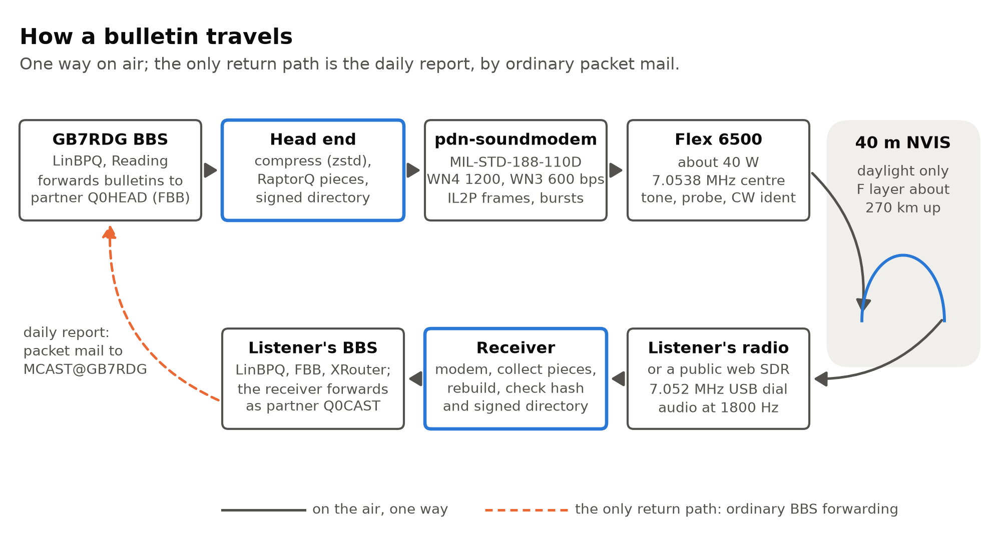

*Figure 1. How a bulletin travels: GB7RDG BBS, head end, pdn-soundmodem, Flex 6500, 40 m NVIS, listener's radio or web SDR, receiver, listener's BBS as Q0CAST; the daily report returns by packet mail to MCAST@GB7RDG.*


The head end transmits MIL-STD-188-110D Appendix D serial-tone waveforms in a 3 kHz channel centred on 7.0538 MHz. Listeners tune 7.052 MHz USB, which puts the signal at 1800 Hz in their audio. The signal occupies about 7.0522 to 7.0554 MHz, clear of the UK HF packet channels at 7.0503, 7.05095 and 7.0516 MHz.

Two waveforms are used, slot by slot in turn: WN4 (BPSK at 2400 baud, rate 2/3 coding, 1200 bps) and WN3 (rate 1/3, 600 bps). From 2 to 7 November WN4 used the long interleaver; WN3 kept the short one throughout. The receiver reads each burst's waveform from its preamble, so a listener needs no setting for it. The modem is pdn-soundmodem, an open-source software modem, which carries IL2P frames with a CRC inside the 110D bit stream.

The station is a Flex 6500 at about 40 W. Each frame is an AX.25 UI frame, from GB7RDG until 11 October and from M0LTE since, and each slot opens and closes with a CW ident.

### 3.2 Why MIL-STD-188-110D

UK HF packet today runs 300 baud AFSK or BPSK, carried as IL2P, in channels about 500 Hz wide, with ARQ: every frame is acknowledged and repeated until it gets through. Winlink stations use PACTOR or VARA, which are proprietary, or ARDOP, which is open; all three are built around a two-way session whose speed is negotiated by feedback. A one-way transmission has none of that to lean on. What it needs from the modem is different:

- **No negotiation.** Every MS110D burst starts with a preamble that says which waveform and interleaver follow, so a receiver that has never heard the station decodes whatever comes, at whatever speed (autobaud). The sender can change speed slot by slot without telling anyone, which is how mailcast alternated 600 and 1200 bps and later changed interleaver.
- **A ladder of speeds in one channel.** Appendix D defines waveforms from 75 bps to 16 kbit/s in the same 3 kHz (pdn-soundmodem implements them up to 6400 bps), with one receiver. WN3 and WN4 are near the robust end of that ladder; faster ones are there for when a path allows (table below, and section 6.11).
- **Built for the HF channel.** A serial-tone waveform with known probe symbols every few dozen data symbols, an adaptive equaliser, strong convolutional coding and an interleaver handles several milliseconds of multipath and fades of a hertz or so. The 300 baud modes avoid multipath by slowing down instead, at a quarter of WN4's rate.
- **Frames that are perfect or absent.** IL2P frames with a CRC inside the 110D stream either arrive intact or are thrown away: an erasure channel, which is what a fountain code needs.
- **Open and specified.** MIL-STD-188-110D is a public standard (Distribution A), so anyone can build a compatible receiver from the document. pdn-soundmodem's implementation is held, in simulation, to the standard's own performance figures on its Poor HF channel, and WN0 to WN4 had all been decoded over the air before mailcast began.

| Waveform | Rate | Modulation | Code rate | Long interleaver | Standard's target SNR, steady / Poor channel |
|---|---|---|---|---|---|
| WN1 | 150 bps | BPSK | 1/8 | 10.24 s | -3 / 3 dB |
| WN2 | 300 bps | BPSK | 1/4 | 10.24 s | 0 / 5 dB |
| **WN3** | **600 bps** | BPSK | 1/3 | 6.83 s | 3 / 7 dB |
| **WN4** | **1200 bps** | BPSK | 2/3 | 6.83 s | 5 / 10 dB |
| WN5 | 1600 bps | BPSK | 3/4 | 7.68 s | 6 / 11 dB |
| WN13 | 2400 bps | QPSK | 9/16 | 7.68 s | 6 / 11 dB |
| WN6 | 3200 bps | QPSK | 3/4 | 7.68 s | 9 / 14 dB |
| WN7 | 4800 bps | 8PSK | 3/4 | 7.68 s | 13 / 19 dB |
| WN8 | 6400 bps | 16QAM | 3/4 | 7.68 s | 16 / 23 dB |

*Table 1. The MS110D Appendix D waveforms used in this work, all at 2400 symbols a second in 3 kHz (from the M0LTE.Ms110d waveform reference, after the standard's Tables D-II, D-XXXVII and D-LXIV). The target SNR is the standard's requirement in 3 kHz, not what the implementation achieves. Mailcast used WN3 and WN4; the Sweden path tests used the rest.*

The costs are bandwidth and signal level. MS110D fills about 3 kHz, so it cannot sit on the existing narrow packet channels, and many rigs' filters cut into it (section 6.6). It also needs far more computing than the 300 baud modes: MS110D with its equaliser and decoder runs comfortably on a Raspberry Pi but not on the small microcontroller in a typical packet TNC. And it needs more signal than the slowest modes: in simulation WN4 needs about 1.5 dB signal to noise in 3 kHz on a steady signal and 12 to 16 dB on a fading path for 10% frame loss, WN3 a few dB less. The fountain code turns part of that loss into "takes a few more slots" rather than "never arrives".

### 3.3 The timetable

40 m NVIS only carries UK paths in daylight. On 5 October the earliest and latest test slots were heard by none of the UK and Irish web SDRs tried, while those through the middle of the day decoded well. So the head end works out sunrise and sunset at Reading itself, with no internet needed, and transmits every hour on the hour from 2 hours after sunrise to 30 minutes before sunset: 09:00 to 16:00 UTC in October, 11:00 to 15:00 in December. (From 8 November, after this paper's data, v0.34.0 adds evening slots on WN3 after Reading sunset, ending before 22:00 UTC, for listeners further away such as Sweden. They carry everything in rotation on their own piece numbering, so they do not count against the daylight sending strategy, and receivers can opt out.)

A slot lasts at most 10 minutes. The head end first listens for a clear channel, for up to 2 minutes, then sends a 10 s calibration tone, 1.5 s of silence, a 6.5 s sounding probe (section 3.4), a CW ident, and its frames in bursts of up to 18 s (31 s from 2 to 7 November). Each burst is its own transmission with its own preamble. The timetable is sent in every slot, so receivers follow it without being told.

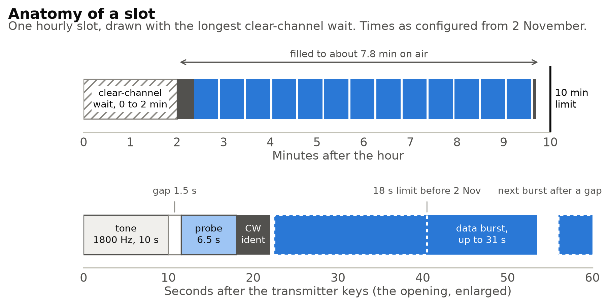

*Figure 2. Anatomy of a slot: clear-channel wait of up to 2 min, 10 s tone, 1.5 s gap, 6.5 s probe, CW ident, data bursts (18 s; 31 s from 2 to 7 November), closing ident, about 7.8 min on air inside the 10 min limit.*

### 3.4 The sounding probe

Since 7 October every slot has opened with a channel sounding: the 10 s tone, then a 6.5 s probe on the tone's own audio frequency. The probe is a Zadoff-Chu sequence of length 255 at 2400 chips per second, shaped with a root-raised-cosine pulse (roll-off 0.15) to fill 420 to 3180 Hz, and repeated 61 times back to back. A Zadoff-Chu sequence correlates to exactly zero against any cyclic shift of itself, so when it arrives by several paths each one shows up as a separate peak. One period lasts 106.25 ms, so any echo up to that late reads out unambiguously; one chip is 0.417 ms, so paths about that far apart are resolved; and each period gives a fresh estimate, so over 6 s the receiver also sees each path's Doppler shift and spread. Averaging 58 periods on top of the 255-chip correlation gain makes the probe measurable at about -15 dB signal to noise in 3 kHz, far below anything the data waveforms can decode.

The receiver finds the probe from the tone's end, correlates each period against the reference (which it builds with the very same code the transmitter uses), and accepts it only if the averaged profile stands at least 6 dB over its floor in at least half the periods. Paths closer than 0.4 ms count as one mode. Each mode is then remeasured on its own Doppler frequency, which removes the small delay error a frequency offset causes in a Zadoff-Chu probe and discards "modes" that were only another mode's shoulder.

The receiver has no absolute timing, only the delays between modes, but that is enough. With the mirror model over a round Earth, the gap between the one-hop (1F) and two-hop (2F) modes depends mainly on the layer's virtual height and hardly on distance for nearby stations: within about 200 km of Reading, a 2F mode 1.9 ms after 1F means a layer about 290 km up. A later mode is only named 2F if its delay fits an F layer between 200 and 450 km, and a height is only reported from such a confirmed pair, never from a single mode. The heights in this paper are therefore inferences under that model, bounded by its 200 to 450 km window, not independent measurements of the layer. The same model then places each ground bounce along the great circle, and the receiver names it from a small built-in gazetteer ("near Aberystwyth", or a sea and shipping forecast area). The full method is described in `docs/channel-probe.md`.

When the probe cannot be measured, the receiver falls back to the decoded data bursts as the known signal, which works only down to about +1 dB.

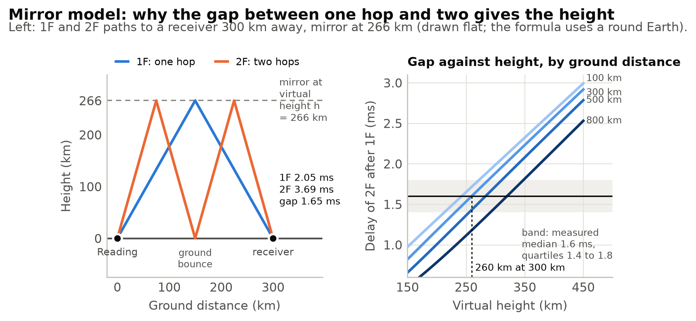

*Figure 3. Mirror model: 1F and 2F paths to a receiver 300 km away, and the 1F to 2F delay against virtual height for 100 to 800 km, with the measured median gap of 1.6 ms reading as about 260 km at that distance (the median measured height, 268 km, comes from receivers at many distances).*

### 3.5 Framing and coding

Each bulletin is compressed with zstd using a 64 KB dictionary trained on earlier UK bulletins, which brings bulletins to about 30% of their size. The result is cut into 240-byte symbols and coded with RaptorQ (RFC 6330), one source block per bulletin. A RaptorQ encoder can make as many different symbols as it likes, and any K of them, plus a couple more, rebuild a bulletin that is K symbols long. A median bulletin in this study was 5.3 kB of text, about seven symbols once compressed.

Each frame carries one symbol, 271 bytes in all: a version byte, flags, an 8-byte object ID, the dictionary ID, the RaptorQ transmission information, the symbol's number, the symbol and a CRC-32. The object ID is the first 8 bytes of a SHA-256 hash over the dictionary ID and the object, so every object checks itself.

**Object types.** The first byte of every object says what it is, so the same frames, coding and receivers can carry more than bulletins:

| Type | What it carries |
|---|---|
| 1 | A packet mail bulletin, in the FBB/BPQ message format |
| 2 | The directory |
| 3 | A DAPPS message (reserved) |
| 4 | A propagation reading (the ionosonde's, or PSK Reporter's), a few dozen bytes |
| 5 | A bulletin's envelope: what one station's copy has besides the canonical bulletin (section 8) |
| 6 to 111 | Unassigned |
| 112 to 127 | Experiments, never assigned |

*Table 2. Object types. The top bit of the same byte says a metadata block follows, which a reader that does not understand it skips.*

A receiver handles each object by its type: bulletins go to the BBS, the directory is read, readings are shown, envelopes are checked against the signed directory. A type it does not handle never reaches the BBS; since 31 October (receiver 0.27.0) the receiver keeps such objects, within a size limit, for other programs to collect through its API. Receivers already in the field drop types they do not know. So new kinds of traffic can be added later without breaking any listener: the propagation readings arrived in the first week and the envelopes on 30 October, both over receivers that had never heard of them. One transmission becomes a general one-way carrier for small objects, of which bulletins are only the first use.

Every slot also carries a *directory*: the bulletins in rotation, the timetable and the slot's waveform. Since 15 October directories are signed with Ed25519, and a receiver holds back anything that only an unsigned or unverified directory lists.

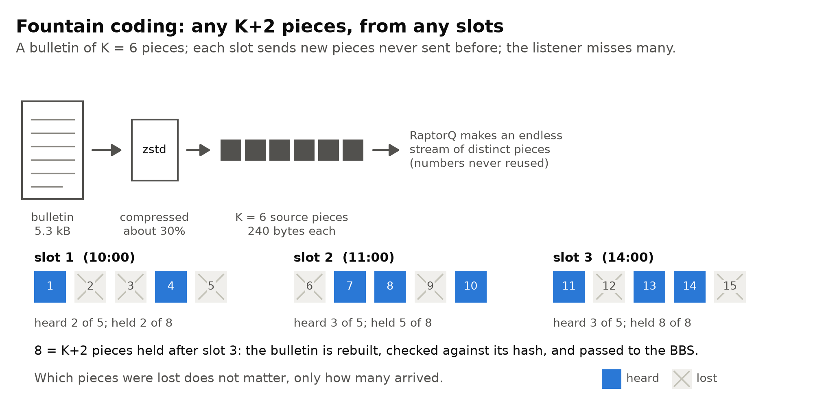

*Figure 4. Fountain coding: a bulletin is compressed and cut into K source pieces; each slot sends new pieces, and a listener who hears any K+2 of them across several slots rebuilds it.*

### 3.6 How much is sent, and for how long

Each slot is filled to about 7.8 minutes on the air while there is anything to send, least-covered bulletins first. Every bulletin gets fresh symbols in every slot until 6 K symbols have gone out or 36 hours have passed: enough that any three slots rebuild it. After that a bulletin is carried only in airtime nothing else wants, up to 10 K or 48 hours. No symbol number is ever sent twice, so everything a listener hears is new to them.

From 6 October the head end sent 25,397 frames, about 6.1 MB of symbols, for 465 bulletins totalling 3.5 MB of text (about 1 MB compressed, at the dictionary's typical 30%). Not all of those frames carry bulletins: the directory takes 20 to 35 frames in every slot, about 40% of a 75-frame WN3 slot, and the readings four more. 2.7 MB of the 3.5 MB (77% of the text, and about two thirds of the bulletins by count) were one sender's daily news digests.

### 3.7 Propagation readings

Each slot also carries two small readings: whether 40 m is open from Reading at 100, 500 and 1000 km by the latest ionosonde sounding (Fairford, Chilton or Dourbes), and the same judged from the last 30 minutes of FT8, FT4 and WSPR spots between UK and Irish stations on PSK Reporter. They are observations only, and never change what or when the head end sends. Section 6.9 asks how well they predicted reception.

### 3.8 The receiver

The receiver is one program. It takes audio from a sound card, from SDRconnect, or from a public UberSDR web receiver, and runs the MS110D modem itself. When it has enough symbols of a bulletin it rebuilds it, checks it against its ID and the signed directory, and logs in to the listener's LinBPQ, FBB or XRouter BBS as forwarding partner Q0CAST to offer it. The BBS keeps or refuses it by BID like any partner. Symbols are kept on disk for 14 days, so pieces heard in different slots and on different days add up.

A listener with one radio can share it with their packet node. The receiver turns the node's transmitter off on that port, retunes the rig through Hamlib for each slot, and puts everything back afterwards. A receiver on a web SDR listens to each slot for about 14 minutes and stays inside the 3 hours a day that those SDRs allow.

If the listener turns it on, the receiver sends a short public daily report: one line per slot with the frames decoded, the tone's signal to noise, the propagation readings it heard, and the channel measurement. The reports go as bulletins to `MCAST@GB7RDG`, and most of section 6 is built from them.

## 4. How it changed over the month, and why

Mailcast was not designed once and then measured. It went from a first test transmission on 5 October to its present form in 70 releases, and most changes came from what the previous days' slots, the survey or a listener showed. This section follows the changes that matter for reading the results; the full dated record, with sources, is `paper/notes/evolution-timeline.md`.

### 4.1 Phases

1. **5 October: from a one-off test to hourly daylight slots.** The first slots, at 06:59 and 10:15, were barely heard, and a full test at 11:52 was wiped out because the original channel sat on top of the UK 40 m packet channels. The signal moved up to its present 7.0538 MHz centre, the pieces shrank from 940 to 240 bytes in bursts of at most 18 s, and the modem's drive was doubled. The 15:17 and 16:00 tests then rebuilt all six bulletins at most web SDRs. The tests went well enough that Tom moved straight from one slot a day to hourly ("Such a success I think we will do an hourly mailcast"), then to daylight only, because the earliest and latest test slots had been heard by nobody.
2. **6 to 9 October: fill every slot, and add instruments.** The first daylight morning showed the fixed-share plan wasting airtime (the 10:00 slot keyed nothing at all) while weak listeners got little. From 11:00 on 6 October the head end filled every slot to its airtime budget and alternated WN4 and WN3. The same days added the ionosonde and PSK Reporter readings, the sounding probe, the daily reports and the dial setting for narrow rig filters (section 6.6). The daily reports began as personal mail to M0LTE and became public bulletins on 8 October, so that anyone on GB7RDG could read them.
3. **9 to 20 October: identity, trust and retirement.** The transmitting callsign changed from GB7RDG to M0LTE on 11 October. Directories were signed from 15 October. A look at retired bulletins on 14 October led to the leftover tier and to receivers giving up on bulletins no longer sent. The web SDR survey ran through this phase.
4. **22 to 27 October: any station can transmit.** With John G8BPQ preparing a second station, the head end lost its built-in GB7RDG settings, slots could start at any minute, and receivers followed every station they knew. The modem's probe pattern was corrected to follow MIL-STD-188-110D exactly.
5. **28 October to 1 November: Model B.** Bulletins went out in canonical form at a fixed piece size, each station in its own piece order, and a head end could relay what its local receivers heard (section 8).
6. **2 to 7 November: retuning from the daily reports.** A look at 42 daily reports showed that only the strongest listener kept up with everything, and that one sender's daily news digests were 65% of the bulletins taken in. WN4 moved to the long interleaver, bursts lengthened, and those bulk bulletins were sent last.

### 4.2 The sending strategy

| From | What the head end did | Why |
|---|---|---|
| 5 Oct 06:59 | One slot a day. Each bulletin carried on three days running, about 2 K pieces in all; 940-byte pieces. | The original design: about 120 KB a day, 15 to 24 minutes of WN4. |
| 5 Oct 15:17 | 240-byte pieces, bursts of at most 18 s. | On a busy band almost nothing of the 940-byte frames survived; short pieces also waste less on short bulletins. |
| 5 Oct evening | Hourly, then daylight only: 1.2 K + 2 pieces in a bulletin's first slot, 0.4 K five slots later. | Hourly because the afternoon tests succeeded; each bulletin sent in two slots rather than five because five did not fit December's daylight in simulation. |
| 6 Oct 11:00 | Fill each slot to 7.8 minutes, least-covered bulletin first; each bulletin enough per slot that any three slots rebuild it, at most 0.6 K a slot; retire at 6 K or 36 hours. | The 10:00 slot had sent nothing while 20 bulletins from the unheard 18:00 slot sat unsent. |
| 10 Oct 09:00 | More directory frames per slot: enough for a receiver hearing a quarter of a slot to get it with 80% probability. | G7TAJ, hearing about a quarter of the frames, saw a directory four days old. |
| 15 Oct 10:00 | Leftover tier: after 6 K or 36 hours, a bulletin is carried only in otherwise unused airtime, up to 10 K or 48 hours. | On 14 October, 92 of the 110 bulletins more than 36 hours old had stopped at 6 K, while the weaker survey receivers (M9TWM-1 and G4EYR) each held 44 to 58 bulletins part-built with no way to finish them. In simulation the tier raised the pieces sent per bulletin from 5.9 K to 8.1 K. Tom approved it with two receiver changes ("Do all three") that night. |
| 30 Oct | Fixed 240-octet pieces for every object; canonical bulletins; each station's own scrambled piece order. | So that pieces from different stations combine (Model B). |
| 31 Oct 12:45 | Relayed objects join the same rotation. | A bulletin heard from another station helps listeners in a different skip zone. |
| 2 Nov 13:00 | Bulk senders strictly last; a bulletin not started 48 hours after intake retires unsent. | Daily reports showed only the strongest listener keeping up and one sender's digests making up 65% of what was taken in. A rule to concentrate on a few bulletins at a time was simulated the same day and dropped. |

### 4.3 The waveform

| From | Waveform plan | Why |
|---|---|---|
| 5 Oct | WN4 (1200 bps, short interleaver) only. | The strongest MS110D point already proven on air; WN3 held in reserve. |
| 5 Oct 16:00 | Modem drive doubled, data bursts from about 12 W to 41 W. | The Flex's meters showed the data bursts far below the tone's power. |
| 6 Oct 11:00 | Slots alternate WN4 and WN3, the order shifting each day so every hour gets both. | To compare the two on real mail; receivers follow by autobaud. |
| 26 Oct | The standard's mini-probe pattern only. | The earlier transmitter marked block boundaries the standard does not, which would mislead a receiver written to the standard (found while porting the modem to C++). |
| 2 Nov 11:00 to 7 Nov 16:00 | WN4 on the long interleaver (bursts padded to whole 6.83 s blocks); WN3 unchanged. | The Sweden path tests (section 6.11): on 31 October WN4 with the long interleaver got 60% of its frames through in the morning against 36% for the short one, and 40% against 31% over the day. Proposed with the 2 November review of the daily reports and approved by Tom the same morning. |
| 2 Nov 11:00 to 7 Nov 16:00 | Bursts of up to 31 s instead of 18 s. | To fit four long-interleaver blocks (about 28 s with the preamble) in one burst; Tom approved "about 28", and 31 s is what both the head end and the modem needed to allow it. Fewer bursts also save preambles: WN3 slots went from 73 to about 86 frames, and long WN4 slots carried 161 frames. |

Both 2 November waveform changes were undone in the configuration at 23:14 UTC on 7 November, after reception fell sharply with them in place, so the last slot sent that way was 16:00 on 7 November and the first sent the old way 10:00 on 8 November. They turned out not to be the cause: the transmitter's frequency reference was (section 6.3).

Two things follow for reading the results. Most of the reports come from after 15 October, so they describe the filled slots with the leftover tier, alternating WN4 and WN3. And the long interleaver ran only from 2 to 7 November, all of it under the transmitter's reference fault (section 6.3), so it cannot be compared with the short interleaver on the air; the Sweden path tests (section 6.11) compared them directly.

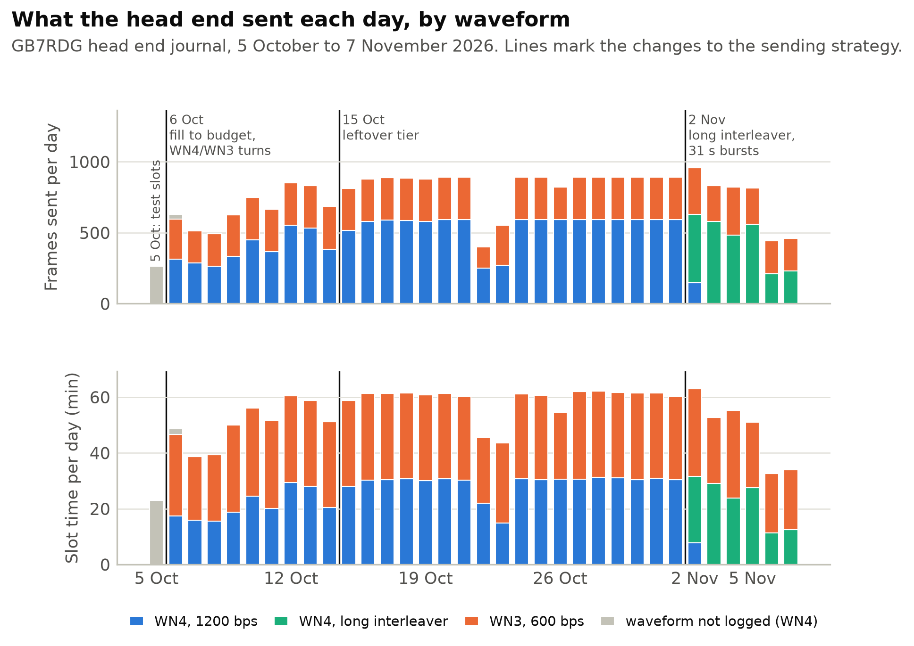

*Figure 5. Frames sent and slot time per day, stacked by waveform, with the strategy changes of 6 October, 15 October and 2 November; 5 October's test slots shown on their own.*

## 5. Data

Three sources, all in this repository:

- **The head end's journal**, from the first test slot on 5 October to 7 November (the figures below start on 6 October, the first day of hourly slots): what each slot planned and sent, on which waveform, for how long, and what was taken in from the BBS (`data/headend-gb7rdg`).
- **A web SDR survey**, 6 to 20 October. Eight receivers on one machine, each listening through a different public UberSDR, from 83 to 544 km away, logged every slot (`data/web-sdr-survey-2026-10`). Two of the SDRs were unreachable for some of the time; those slots are left out. The same eight receivers were started again on the evening of 7 November, with the channel measurement recorded too, to follow the recovery (data from 8 November, copied weekly into `data/web-sdr-survey-2026-11`).
- **Listeners' daily reports**, 131 reports from nine listeners, 8 October to 7 November (`reports/`), frozen as listed in `paper/figures/report-manifest.csv`; eight reports for those dates that reached the archive later (M9TWM's for 31 October to 6 November and GM4CXF's for 7 November) are not included. Most were copied from GB7RDG; some never reached it and were pasted from other BBSes. Reports from 8 to 18 October are incomplete, because GB7RDG then kept bulletins for only a week and the archive was started later; GB7RDG's message index names 12 more whose text is gone.

Throughout, a receiver's *share* is the frames it decoded over the frames sent in the slots it was listening to, and a *receiver-slot* is one receiver listening to one slot. A slot cut short counts the frames it did send; a slot that sent nothing is left out. Days on which a listener's receiver had no audio at all are left out, but slots lost to a shorter audio fault count as heard nothing.

Three cautions apply to every comparison over time. The software changed throughout (the head end went through 37 releases, receivers from 0.4 to 0.33), listeners chose themselves and cover different dates, and several improved their setups during the study. Tone signal to noise on a web SDR also passes through that SDR's own receiver and AGC.

## 6. Results

### 6.1 The transmitter

From 6 October to 7 November the head end ran 259 slots over 33 days: 252 completed, 6 cut short and 1 skipped. A completed slot lasted a median 7.6 minutes from its start to the closing ident, 29.6 hours in all, including any wait for a clear channel. It sent 25,397 frames in 5,182 bursts: 13,500 on WN4, 2,544 on WN4 with the long interleaver, 9,320 on WN3, and 33 in the 6 October 09:00 slot, whose waveform was not logged.

The clear-channel check found the channel busy at the start of 150 of 258 slots and waited for it to clear, usually for only a few seconds. On the afternoon of 22 October four slots sent nothing: the channel read busy throughout, probably local interference, and the modem never keyed. Two more slots were cut short, one by a restart of the head end and one by a dropped connection to the modem.

### 6.2 Who heard it: the web SDR survey

| SDR | Distance (km) | Slots listened | Slots with frames | Frames heard | Median tone SNR (dB) | Bulletins rebuilt |
|---|---|---|---|---|---|---|
| G4WNC | 83 | 58 | 9% | 1% | -8 | 1 |
| G4EYR | 89 | 119 | 50% | 13% | 0 | 80 |
| STUEY3D | 97 | 119 | 87% | 71% | 14 | 198 |
| WESSEX | 135 | 119 | 88% | 80% | 24 | 200 |
| M9TWM-1 | 221 | 111 | 67% | 24% | 3 | 131 |
| EI4HQ | 502 | 119 | 100% | 79% | 13 | 223 |
| M9PSY | 534 | 119 | 96% | 69% | 11 | 220 |
| GI3JMC | 544 | 119 | 1% | 0% | -10 | 0 |

*Table 3. Web SDR survey, 6 to 20 October. "Bulletins rebuilt" counts each bulletin once, when the receiver first completed it; 224 bulletins had been taken in before the survey's last slot. G4WNC was unreachable for 61 of its slots.*

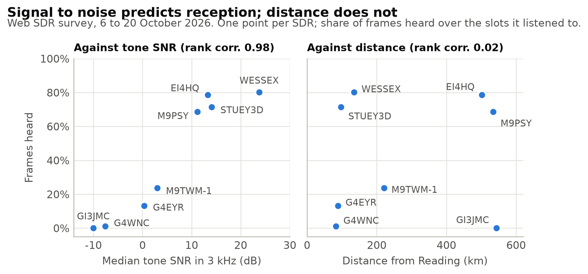

*Figure 6. Share of frames heard by each survey SDR against its median tone SNR and against its distance from Reading: SNR ranks the SDRs almost perfectly (rank correlation 0.98), distance not at all (0.02).*

Distance alone does not decide reception. Two SDRs over 500 km away, in Ireland and Fife, heard nearly as well as the best one 135 km away, while the two nearest, within 90 km of Reading, heard 1% and 13%. G4WNC, the nearest, had decoded 38 of 41 frames on 5 October, so its later silence says more about that SDR than about the path. We cannot separate the path from each SDR's own antenna and local noise with this data, but the tone's signal to noise tracks the share of frames heard far better than distance does.

The four strongest SDRs rebuilt 198 to 223 of the 224 bulletins. Weak receivers rebuilt a good part too: M9TWM-1 decoded only a quarter of the frames sent but rebuilt 131 (58%), and G4EYR heard 13% and rebuilt 80 (36%). This is the fountain code doing its job: a bulletin was spread over several slots and several hours, and a receiver that heard a bit of each often ended up with enough.

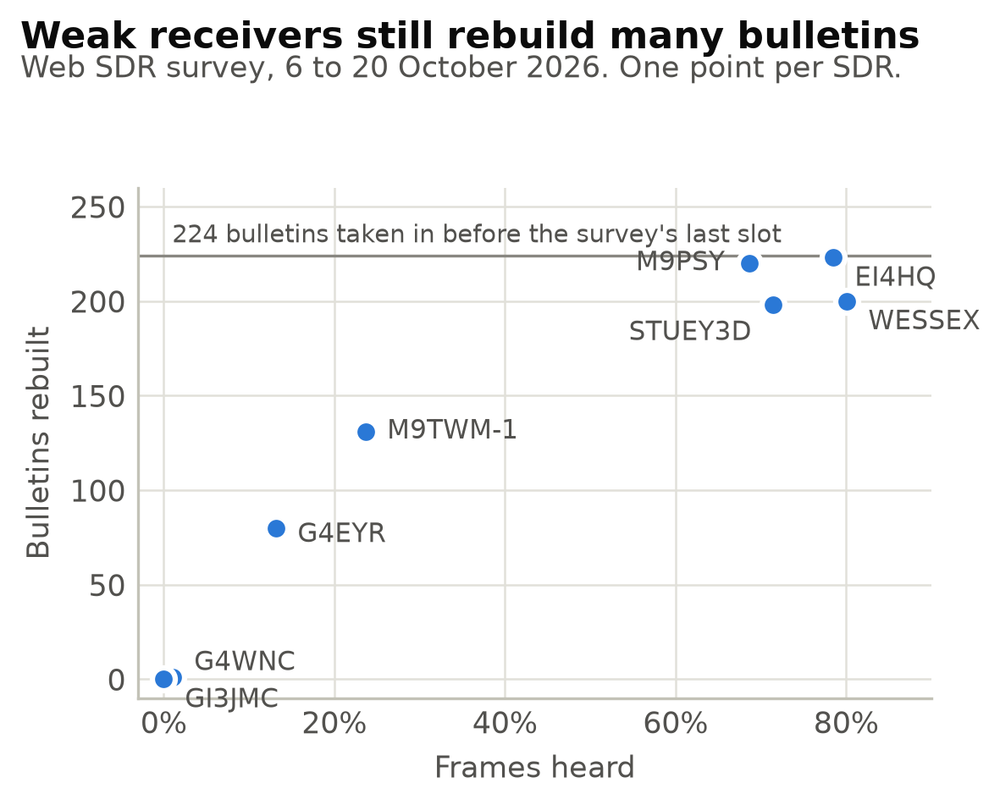

*Figure 7. Bulletins rebuilt by each survey SDR against its share of frames heard: SDRs hearing 13 to 24% of frames still rebuilt 80 to 131 of the 224 bulletins taken in before the survey's last slot.*

The two weeks also differed: the nearer strong SDRs heard much more in the second week (WESSEX 65% then 90%, STUEY3D 51% then 85%), while the distant ones changed little (`paper/figures/heard-share-tables.md`). Most of the difference is two bad days, 6 October (both heard nothing while EI4HQ heard 78%) and 11 October; from 12 October both heard 85 to 98% most days. The receivers' software also changed several times during the survey.

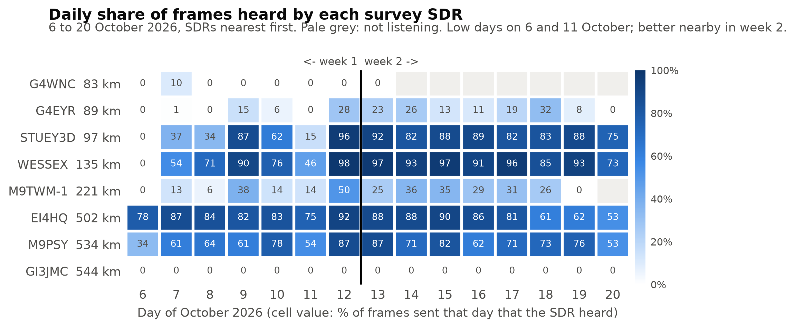

*Figure 8. Daily share of frames heard by each survey SDR, 6 to 20 October: weak days on 6 and 11 October, and the nearer strong SDRs better in week 2.*

### 6.3 Who heard it: listeners' reports

| Listener | Locator | Dates | Days | Slots listened | Slots with frames | Frames heard | To 1 Nov | From 2 Nov | Median tone SNR (dB) | Bulletins rebuilt |
|---|---|---|---|---|---|---|---|---|---|---|
| M7TAW | IO91ma | 24 to 31 Oct | 7 | 56 | 86% | 57% | 57% | - | 10 | 111 |
| M0NVK | IO90hr | 15 Oct to 6 Nov | 10 | 71 | 87% | 55% | 67% | 37% | 20 | 124 |
| GM4CXF | IO75qn | 25 Oct to 6 Nov | 13 | 99 | 98% | 50% | 66% | 21% | 11 | 165 |
| M9TWM | IO93fj | 8 to 30 Oct | 9 | 72 | 89% | 24% | 24% | - | 5 | 63 |
| G8BPQ | IO92kx | 8 to 31 Oct | 23 | 168 | 84% | 23% | 23% | - | 4 | 163 |
| GM8BPQ | IO68vl | 8 Oct to 7 Nov | 25 | 180 | 77% | 14% | 17% | 2% | 4 | 99 |
| G7TAJ | IO81le | 8 Oct to 3 Nov | 18 | 135 | 64% | 13% | 14% | 5% | 8 | 79 |
| MM0MQN | IO86bd | 28 to 29 Oct | 2 | 12 | 33% | 3% | 3% | - | -4 | 0 |
| EI7KX (web SDR) | - | 2 to 7 Nov | 6 | 41 | 88% | 18% | - | 18% | 4 | 43 |
| M7TAW (WESSEX SDR) | - | 21 to 26 Oct | 3 | 19 | 89% | 75% | 75% | - | 22 | 48 |
| M0NVK (WESSEX SDR) | - | 9 to 13 Oct | 4 | 29 | 97% | 89% | 89% | - | 26 | 53 |
| G7TAJ (WESSEX SDR) | - | 26 to 27 Oct | 2 | 14 | 93% | 66% | 66% | - | 27 | 46 |

*Table 4. Listeners' daily reports, 8 October to 7 November, on their own equipment (M9TWM's own UberSDR counts as his) and, below, the days some listened through a public web SDR. Nine report-days with no audio at all are left out. The listeners cover different dates, so the table compares dates as much as stations.*

The picture matches the survey. On their own equipment three listeners heard about half the frames or more and four heard 13 to 24%; MM0MQN, in central Scotland, sent only two reports. All but MM0MQN heard frames in most slots, from 64% of slots for G7TAJ to 98% for GM4CXF in Ayrshire. GM8BPQ, on Lewis in the Outer Hebrides about 850 km from Reading, heard frames in three slots out of four.

**Reception fell sharply in early November.** Every listener who reported on both sides of 2 November heard much less afterwards: GM4CXF from 66% to 21%, M0NVK from 67% to 37%, G7TAJ from 14% to 5%, GM8BPQ from 17% to 2%. The fall began on 31 October, but three things changed on 2 November that at first looked to blame: WN4 moved to the long interleaver, bursts lengthened from 18 s to 31 s on both waveforms, and one sender's digests were sent last; from 3 November the first slot was also 10:00 rather than 09:00 as the days shortened. Of these, only the burst length touched both waveforms: WN3 kept the short interleaver, and sending digests last changes what is sent, not how. The drop is as large on WN3 (GM4CXF 73% to 22%, GM8BPQ 20% to 3%).

Slot by slot, from 15:00 on 31 October to the end of 1 November reception was poor everywhere and often no tone was heard, which looks like the storm of section 6.12. On the morning of 2 November it recovered: GM4CXF heard 62% and 53% of the 09:00 and 10:00 slots, still sent in 18 s bursts. From 11:00, the first slot with 31 s bursts, it heard 5 to 21% while its tone stayed at 10 to 15 dB. Over all listeners from 25 October, in slots with a tone of 8 dB or more, the share heard was 61% with 18 s bursts (122 receiver-slots) and 24% with 31 s bursts (56), on both waveforms alike. That, and recordings showing the receiver's equaliser losing the signal partway through November bursts (only 27% of bursts ran to their normal end from 3 to 6 November, against 79% before), made the longer bursts look guilty. Sources for these and the figures below are listed in `paper/notes/november-drop.md`.

**The cause was the transmitter's frequency reference.** Since 26 October the Flex 6500 had taken its 10 MHz reference from an external GPS-disciplined oscillator. That oscillator keeps its 10 MHz output running when it loses GPS lock, so the Flex went on reporting "external reference locked" while its frequency wandered. Every receiver, near and far, saw the result as a Doppler spread of about 1 Hz on GB7RDG's signal, against 0.2 to 0.3 Hz in October. The fault most likely began on the afternoon of 31 October, when reception first fell, overlapping the storm of section 6.12.

The test came on 8 November. The 10:00 slot (WN3, 600 bps) was the first back on 18 s bursts and the short interleaver, and reception was still poor: WESSEX heard 7 of 51 frames with its tone at 25 dB, EI4HQ 10 at 22 dB, STUEY3D 8 at 16 dB, with the probe reading 1.15 to 1.34 Hz of Doppler spread. Tom power-cycled the GPS oscillator and the Flex at about 10:50. At 11:00 (WN4, 1200 bps, also 18 s bursts) WESSEX, EI4HQ and STUEY3D each heard all 51 frames, M9TWM-1 41 and M9PSY 34, the Doppler spread was back at 0.13 to 0.29 Hz everywhere, and every recorded burst ran to its normal end; the more robust waveform had failed before the restart and the faster one succeeded after it. At 13:00 (WN4, 86 frames) WESSEX heard 74, STUEY3D 73, EI4HQ 71 and M9TWM-1 59; the 12:00 slot was lost to a separate fault. Over the whole of 11:00 to 15:00 (312 frames sent), six of the resumed web SDR survey's receivers heard: WESSEX 95%, STUEY3D 93%, EI4HQ 94%, M9TWM-1 79%, M9PSY 56% and G4EYR 17%, all but M9PSY (69% in October) at or above their October levels (GI3JMC heard nothing, as in October, and G4WNC was not listening), with the Doppler spread measured on the bursts at 0.13 to 0.34 Hz. Of the listeners whose reports had landed by that evening, GM4CXF heard 56% of frames in the four slots after the restart (16% in the one at 10:00), and GM8BPQ, the weakest listener, 9% (none at 10:00).

| Receiver | 10:00, before the restart | 11:00, after |
|---|---|---|
| WESSEX | 7 of 51, +25 dB, 0.91 Hz | 51 of 51, +27 dB, 0.19 Hz |
| EI4HQ | 10 of 51, +22 dB, 0.81 Hz | 51 of 51, +19 dB, 0.27 Hz |
| STUEY3D | 8 of 51, +16 dB, 1.01 Hz | 51 of 51, +16 dB, 0.25 Hz |
| M9TWM-1 | 2 of 51, +8 dB, 0.95 Hz | 41 of 51, +14 dB, 0.19 Hz |
| M9PSY | 5 of 51, +9 dB, 0.85 Hz | 34 of 51, +8 dB, 0.29 Hz |
| G4EYR | 8 of 51, +2 dB, 0.94 Hz | 17 of 51, +6 dB, 0.13 Hz |

*Table 5. Frames heard, tone signal to noise and the Doppler spread measured on the bursts, 8 November, either side of restarting the transmitter's frequency reference. Both slots used 18 s bursts on the short interleaver; 10:00 was WN3 (600 bps), 11:00 WN4 (1200 bps), 51 frames each.*

So the 2 November changes were not the cause. They happened to land on a signal that was already degrading, and the slot-by-slot fall at 11:00 that day may simply be the reference getting worse; the longer bursts may have made a bad signal worse, but going back to short ones did not fix it, and the restart did. The receivers' behaviour fits a transmitter wandering in frequency: the equaliser lost the signal partway through bursts, and on our fixed receiver the bursts read a higher Doppler spread than the short probe from 2 November, as a frequency that drifts over a longer key-down would. No receiver change is needed. The sources for every figure here are listed in `paper/notes/november-drop.md`.

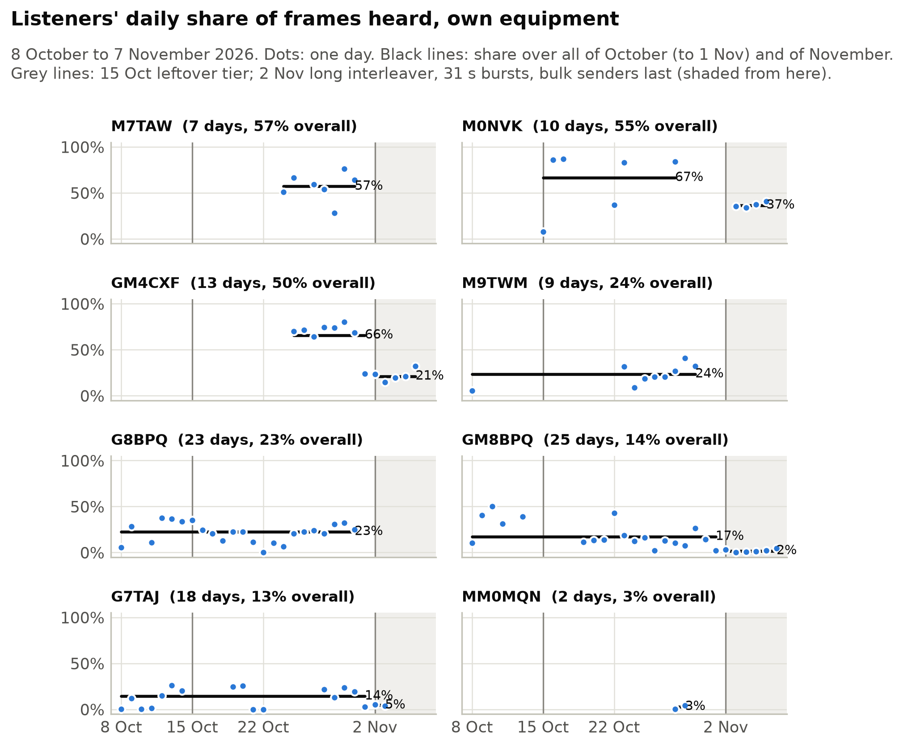

*Figure 9. Listeners' daily share of frames heard on their own equipment, 8 October to 7 November, with October and November shares: the November drop for GM4CXF, M0NVK, GM8BPQ and G7TAJ, from the transmitter's reference fault of 31 October to 8 November (section 6.3).*

### 6.4 Did listeners already have the bulletins?

A rebuilt bulletin is offered to the listener's BBS like any forwarded one, and the BBS says whether it is new or one it already holds, by its BID. Reports since 10 October count both, which answers a question Perry M0PYL asked: does mailcast deliver anything ordinary forwarding doesn't?

| Listener | Report days | Rebuilt | New to the BBS | Already had | Share already had |
|---|---|---|---|---|---|
| GM4CXF | 13 | 165 | 165 | 0 | 0% |
| EI7KX | 6 | 43 | 38 | 0 | 0% |
| G8BPQ | 22 | 148 | 147 | 1 | 1% |
| GM8BPQ | 23 | 80 | 78 | 1 | 1% |
| M7TAW | 10 | 159 | 136 | 19 | 12% |
| M0NVK | 16 | 158 | 6 | 152 | 96% |
| G7TAJ | 21 | 122 | 0 | 122 | 100% |
| M9TWM | 9 | 63 | 0 | 63 | 100% |
| All | | | 570 | 358 | 39% |

*Table 6. Bulletins each listener's BBS took as new against those it already held, over every report that counts them (receivers since 10 October) up to 7 November. "Already had" means the BBS held that BID already, whether from ordinary forwarding or an earlier copy; "rebuilt" can exceed the two columns' sum where a delivery was still pending.*

It splits sharply by station. For GM4CXF in Ayrshire, GM8BPQ on Lewis and G8BPQ (and EI7KX over six days), mailcast delivered nearly every bulletin before ordinary forwarding did, if forwarding would have brought it at all. M0NVK's, G7TAJ's and M9TWM's BBSes, well connected to the forwarding network, already held almost everything by the time mailcast rebuilt it. The reports do not say how much earlier the other route was, so for those stations mailcast is a second path rather than a faster one. The figures include the days of the transmitter fault (section 6.3), when fewer bulletins were rebuilt at all.

### 6.5 Waveforms: 1200 bps against 600 bps

| Receiver | Share heard, WN4 | Share heard, WN3 | Frames a minute, WN4 | Frames a minute, WN3 |
|---|---|---|---|---|
| WESSEX | 80% | 82% | 14.9 | 7.9 |
| EI4HQ | 76% | 83% | 14.2 | 8.0 |
| STUEY3D | 69% | 76% | 12.9 | 7.4 |
| M9PSY | 66% | 75% | 12.3 | 7.2 |
| M0NVK | 55% | 54% | 10.7 | 5.4 |
| M7TAW | 55% | 60% | 10.7 | 5.9 |
| GM4CXF | 48% | 54% | 9.4 | 5.5 |
| M9TWM | 21% | 29% | 3.9 | 2.8 |
| EI7KX (web SDR) | 19% | 16% | 3.8 | 1.7 |
| G7TAJ | 12% | 15% | 2.3 | 1.5 |
| G4EYR | 12% | 16% | 2.2 | 1.5 |
| G8BPQ | 15% | 36% | 2.9 | 3.5 |
| GM8BPQ | 10% | 21% | 1.8 | 2.1 |
| MM0MQN | 2% | 6% | 0.3 | 0.6 |

*Table 7. Frames heard on WN4 and WN3 slots, as a share of what was sent and per minute of slot time, for the survey SDRs and listeners (own equipment) that heard both. WN4 includes its long-interleaver slots from 2 November. Each frame carries the same 240-byte piece on either waveform, so frames a minute is the rate at which bulletin data arrived. M9TWM-1 matches M9TWM and is not repeated.*

WN3 is heard a little more often than WN4 by most receivers, but sends half as many frames a minute, so WN4 delivered more data a minute to every receiver except the three weakest: G8BPQ and GM8BPQ, where WN3 more than doubled the share heard, and MM0MQN. For those the order reverses, though only modestly (3.5 against 2.9 frames a minute for G8BPQ). Alternating the two cost most receivers some throughput to help a few; choosing the waveform per slot, or per listener group, from the channel measurement and the daily reports is future work.

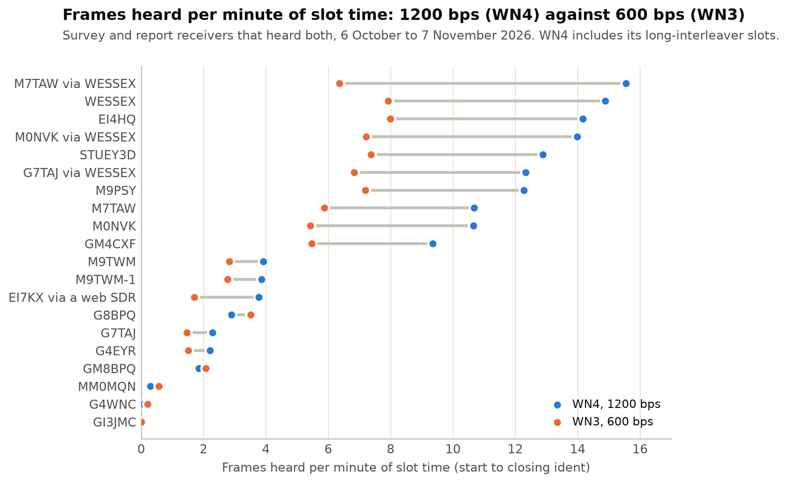

*Figure 10. Frames heard per minute of slot time on WN4 (1200 bps) and WN3 (600 bps) for every receiver that heard both: strong receivers get about twice as much through on WN4; for weak ones the two are close.*

### 6.6 Through an ordinary rig's filters

A Flex or an SDR passes the whole 3.24 kHz signal. Most listeners' rigs do not: SSB and data filters of 2.1 to 2.7 kHz are typical, and they usually sit around 300 to 2700 Hz in the audio, below the signal's 1800 Hz centre. One listener's FT-450D, measured in its data mode, passed 367 to 2190 Hz. The MS110D signal is 2400 Hz wide at its core, so such a filter always cuts into it.

Before the first transmission we simulated this (pdn-soundmodem, `docs/dev/ms110d/evidence/2026-10-04-filter-width`): 111,000 frames of WN4 and WN3 through models of 2.4, 2.7 and 3.0 kHz receive filters, both an 8-pole crystal filter and a linear-phase DSP filter, on a steady signal and on the moderate and poor ITU-R F.1487 mid-latitude fading channels, with the transmit pulse roll-off varied from 0.35 down to 0.05. The findings:

- **A 2.4 kHz filter costs about half a dB on a steady signal and 1 to 2 dB on a fading path** for WN4, about 1 dB for WN3, plus a few percent of frames that more signal does not bring back. 2.7 and 3.0 kHz filters cost between nothing and 1 dB, mostly about half a dB.
- **Narrowing the transmitted signal does not help.** The core is 2400 Hz whatever the roll-off; a narrower roll-off only trims the skirts and makes the pulse ring longer, which the receiver handles worse on a fading channel. Through a 2.4 kHz filter on the poor channel, WN4 lost 21% of frames at roll-off 0.35 and 30% at 0.05. So the transmitter keeps the standard's 0.35.
- **The receiver need not match a narrower transmitter**: its equaliser absorbs the mismatch.
- **Frame length mattered more than any filter.** On the poor channel a 960-byte WN4 frame needed about 16 dB for 10% loss, a 255-byte one about 12.4 dB, which is one reason the transmitter moved to 240-byte pieces on the first day.

Real recordings then showed how much the filter's position matters. On 8 October recorded slots were played through a 2.1 kHz DSP filter and a 2.4 kHz crystal filter. With the signal at 1800 Hz in the audio, the 2.1 kHz filter kept 16 of 36 frames; moving the dial 300 Hz up, so the signal sat at 1500 Hz, nearer the middle of the filter, kept 30 of 36. Through the 2.4 kHz crystal filter it was 23 against 34 (pdn-mailcast PR #65). The signal tolerates losing a little at both edges far better than losing a lot at one.

So the receiver now puts the signal in the middle of the listener's own filter rather than asking them to change the rig. "Measure my filter" listens to about 10 s of band noise between slots, finds the passband's edges, and sets the dial so that the 7.0538 MHz centre lands in the middle of it: for the FT-450D above, a dial of 7.05252 MHz. Listeners can also type the edges from their rig's manual. SDRs, web SDRs and Flex radios stay on 7.052 MHz.

Two gaps remain. Neither study tested a narrow *transmit* filter, which matters for Model B: a second station transmitting from an ordinary rig puts its own filter in the path, ahead of the noise rather than after it, and the effect on reception has not been measured. And we have not yet compared listeners' reception before and after they changed dial, since the reports do not record the dial.

### 6.7 The sounding probe in use

Of the 896 report slots in which the head end sent frames, the probe gave a channel measurement in 624 (70%). In 64 of those no data frame was decoded at all: the probe saw the path when the data could not get through, at tone signal to noise ratios down to -16 dB. The data bursts gave the measurement in another 135 slots where the probe was not found, and 137 slots had no measurement at all, 96 of them because nothing was heard.

The probe's value to a listener is that it answers "is there a path, and what is it like?" even in a slot that delivers nothing, and a receiver's status page says so in a line such as "2 paths: 1 hop, and 2 hops 1.9 ms later, 17 dB weaker. Reflection about 290 km up. Doppler spread 0.2 Hz: steady." Its value to this study is the measurements in the next section, four fifths of which come from the probe.

### 6.8 The channel

Receivers measure the path in each slot from the sounding probe, or failing that from the data bursts. Across 759 measured report slots:

- **Propagation modes.** One mode in 243 slots, two in 355, three in 141, four in 20.
- **Virtual height.** Median 268 km, quartiles 246 to 290 km, inferred from the 1F to 2F delay gap (section 3.4).
- **Second mode.** Median 1.6 ms after the first (quartiles 1.4 to 1.8 ms), and 12 dB weaker (quartiles 15 to 6 dB weaker). Because the model names a mode 2F only if its delay fits an F layer, the height and this delay are two readings of the same measurement, not independent confirmations.
- **Delay spread.** Median 0.42 ms, quartiles 0.29 to 0.57 ms.
- **Doppler spread.** Median 0.33 Hz, quartiles 0.24 to 0.52 Hz. These figures include November, when the transmitter's faulty reference added about 1 Hz (section 6.3); before the fault (to 31 October 14:00) the median was 0.30 Hz (601 slots).

Against the mid-latitude test channels of ITU-R F.1487, the two-path delay of 1.6 ms lies between the moderate (1 ms) and disturbed (2 ms) channels, and the October Doppler spread between the quiet (0.1 Hz) and moderate (0.5 Hz) ones: a channel the 110D equaliser is designed for, fading slowly. In this data reception looks limited more by signal to noise and interference than by the channel's shape, though we have not tested that directly.

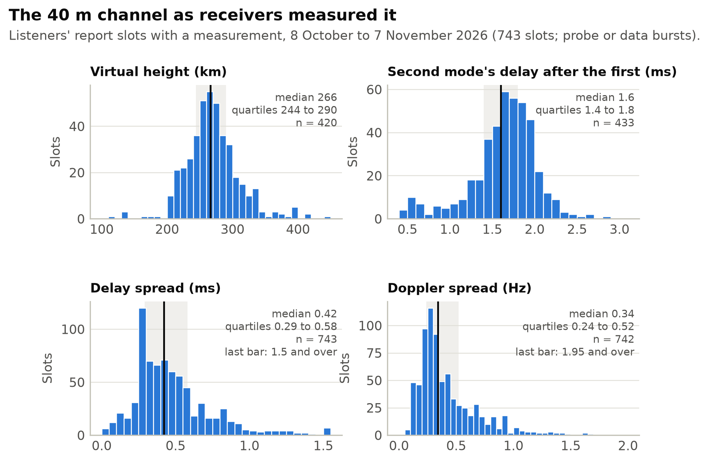

*Figure 11. Distributions of virtual height, second mode's delay, delay spread and Doppler spread over 759 measured report slots, with median and quartiles November's Doppler values include the transmitter's reference fault.*

By hour of day, report slots with frames ranged from 73% at 09:00 UTC to 88% at 14:00, and the share of frames heard from 28% to 35%, with no strong pattern across the daylight window. The 09:00 slot ran only until 2 November, before the November drop, so it is if anything flattered. The median virtual height stayed between 258 and 277 km from hour to hour, again with no clear trend over the day.

### 6.9 Did the propagation readings predict reception?

| Source | Verdict | Receiver-slots | With frames | Frames heard |
|---|---|---|---|---|
| Ionosonde | good | 833 | 83% | 44% |
| Ionosonde | marginal | 658 | 65% | 35% |
| Ionosonde | unknown | 232 | 78% | 26% |
| PSK Reporter | good | 1689 | 76% | 39% |
| PSK Reporter | unknown | 34 | 68% | 29% |

*Table 8. The verdict the head end logged as each slot began, against what the survey and report receivers heard in that slot. 56 receiver-slots had no verdict logged.*

The ionosonde verdict separates slots modestly: receivers heard 44% of frames in slots it called good and 35% in those it called marginal. Marginal verdicts cluster at the first and last slots of the day, and almost all the unknown verdicts fall in November, when the ionosonde feed was often stale, so the unknown row largely reflects the November drop. PSK Reporter called 40 m open in essentially every slot. FT8 decodes far below what MS110D needs, so "open for FT8" says little about a 1200 bps link; the median SNR of the spots behind each verdict may predict better, and is left for later analysis.

### 6.10 Interference and failures

The channel around 7.052 to 7.055 MHz is shared. Listeners reported FT8, VARA and broadcast signals over the mailcast signal. On 30 October an over-the-horizon radar swept across it; in Sweden it wiped out reception of a path test, while G7TAJ reported still decoding 1200 bps through it. On 22 October local interference kept the channel reading busy all afternoon and four slots sent nothing. Reports themselves were sometimes lost on their way back: one listener's BBS offered five reports to a neighbouring BBS that had not set it up as a forwarding partner, and every offer was refused.

### 6.11 Beyond the UK

Daz SA6DAZ, near Gothenburg (JO67fm, about 1,100 km from Reading), lent his station from late October: an IC-7300 on a resonant dipole about 8 m up, broadside to the UK, with a Raspberry Pi running pdn-soundmodem and the mailcast receiver. 1,100 km is well beyond the NVIS footprint the design assumed, and we expected little.

**Mailcast in Sweden.** From 30 October to 7 November the receiver listened to 65 daylight slots. It heard frames in 46 of them, 875 frames in all, and completed 30 bulletins. Tone signal to noise ranged from -9 to +14 dB. Its median virtual height was 310 km (43 measurements), higher than the UK receivers' 268 km, as a longer one-hop path off the same layer would suggest under the model. On 6 November at 14:00 UTC its probe resolved three paths: one hop off the E layer, one hop off the F layer 0.5 ms later at about the same strength, and two F hops 1.6 ms after that, 8 dB down.

**Path tests.** Between mailcast slots, from 30 October to 1 November, the head end sent 136 rounds of test bursts to the same station, each round a tone and probe and then one burst of each of eleven MS110D waveform and interleaver combinations, recorded and decoded in Sweden. At 6 to 9 dB signal to noise in 3 kHz the faster waveforms were still useful: WN5 (1600 bps) decoded 95% of its frames, WN13 (2400 bps) 89% and WN6 (3200 bps) 82%, while WN7 (4800 bps) managed 12% and WN8 (6400 bps, 16QAM) none. At 12 to 15 dB WN8 decoded 58%. The robust end, WN1 to WN4, decoded most frames from around 0 dB upwards. These are close to the standard's targets in Table 1, given that the path was fading.

From the afternoon of 31 October these path tests and the reception figures above ran on the transmitter's faulty reference (section 6.3), so if anything they understate what the path supports.

So a single transmitter on 40 m reaches well into Scandinavia in daylight, at least in autumn, and the channel there often supports waveforms two to three times faster than mailcast used.

### 6.12 Space weather and the ionosphere

We compared reception with the daily geomagnetic and solar indices (Kp and Ap, F10.7 solar flux, sunspot number, flares) and with the ionosonde's foF2 that the head end logged as each slot began. The full analysis is in `paper/notes/space-weather.md`.

| foF2 at the slot | Survey SDRs: share heard | Receiver-slots |
|---|---|---|
| under 6 MHz | 13% | 40 |
| 6 to 7 MHz | 34% | 227 |
| above 7 MHz | 48 to 53% | 560 |

*Table 9. Survey reception, 6 to 20 October, against the F2 critical frequency at the slot (Dourbes or Fairford ionosonde).*

- **foF2 is the one ionospheric measure that clearly goes with reception.** Below about 7 MHz, close to the 7.05 MHz carrier, near-vertical signals pass through the layer, and receivers heard far less: 13% under 6 MHz against about half above 7 MHz (Table 9). This holds within each hour of the day, so it is not just the daily cycle. It is clear for receivers within about 250 km (Spearman rank correlation +0.3 to +0.5, on a scale from -1 to +1) and absent for those 500 to 850 km away, whose more oblique paths are supported by a lower foF2.
- **Day to day, Kp, Ap, F10.7 and sunspot number show nothing measurable** (daily share against Ap: rank correlation +0.07 over 15 survey days, -0.06 over 23 listener days, both with wide intervals). The one strong storm, Kp 7.3 on the evening of 10 October, left a one-day dip: the four strong survey SDRs heard 75% on the 10th, 48% on the 11th and 93% on the 12th. Four M-class flares fell inside slots with no visible effect. One storm and four flares are anecdotes, not a result.
- **The November drop was not space weather.** A smaller storm (Kp 5.7) from the evening of 31 October pushed foF2 below 7 MHz in every slot on 1 November, and reception and even the tone were poor until it passed. From 3 to 7 November Kp was low, foF2 was 7.8 to 9.7 MHz and tones were as strong as before, yet matched by receiver, hour and foF2, receivers heard only about a third of the frames their late-October rates predict. What the indices could not show was the transmitter itself: its frequency reference had lost lock, smearing the signal by about 1 Hz from 31 October until it was restarted on 8 November (section 6.3).
- **The probe's virtual height barely follows foF2** (rank correlation -0.13, 430 slots), a little higher when foF2 is close to the carrier, as group delay near the critical frequency would suggest.

Measured layer heights (hmF2) could not be fetched for comparison: the GIRO service was unavailable throughout.

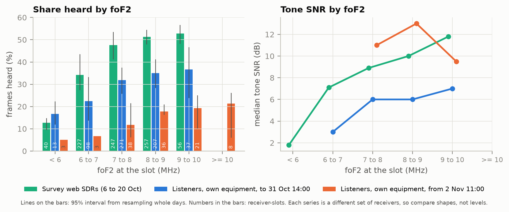

*Figure 12. Share of frames heard against the ionosonde's foF2 at the slot, for near and distant receivers.*

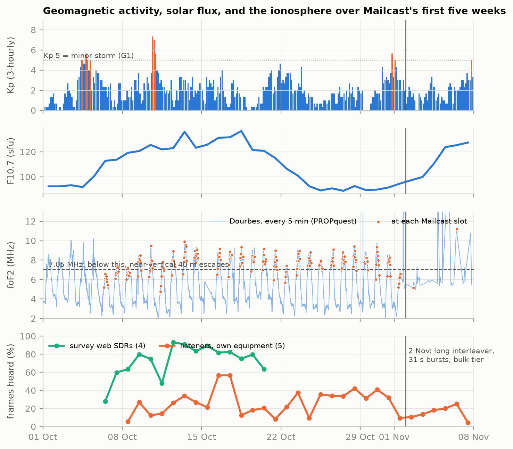

*Figure 13. Kp, F10.7 solar flux and foF2 (at each slot, and continuously) above daily reception for M9PSY, four survey SDRs and five listeners, 1 October to 7 November, with the 31 October storm and the 2 November change marked. The 10 October storm (Kp 7.3) shows as a one-day dip; the lasting fall from 31 October does not follow the ionosphere (it was the transmitter's reference, section 6.3).*

## 7. Lessons from operation

**Sharing a radio is the hard part.** Most listeners already run a packet node, and the receiver has to borrow the radio for each slot: stop the node transmitting, retune, and put everything back. Rig modes caught people out (a Xiegu G90 needs its UD mode rather than USB for its wider filter), as did receive filters narrower than the signal (section 6.6). The receiver now defaults the rig to PKTUSB, and places the signal in the middle of whatever filter the rig has rather than asking anyone to widen it.

**Watch the transmitter's reference, not just its status.** For a week the station's GPS-disciplined reference had lost lock while the radio still reported it locked, and nothing in the station's own logs said so. The receivers' channel measurements did, though the jump in every site's Doppler spread coincided with a storm and was first read as the band. A transmitter on a precise frequency needs an independent check of its lock, and a network of receivers that measure the channel is one.

**Getting reports back is a routing problem.** The daily report travels by ordinary packet mail. Several listeners' reports never reached GB7RDG, because some BBS along the way had not set up the next one as a forwarding partner. Nobody has a full map of who forwards to whom any more.

**Words and callsigns matter.** The UK licence allows messages to be "transmitted by a Beacon or via a Data Station for reception by Amateurs", but "broadcast" is a loaded word in amateur radio, and we say *transmission*. Transmitting under the BBS's callsign was technically outside the terms of GB7RDG's licence, so from 11 October the head end transmits as M0LTE.

**Setting up a receiver is not always simple.** One listener's SDRconnect link failed for days because a VPN on the Windows PC hid it from the local network, and two copies of SDRconnect were running; once working, his reception changed from a tone at -15 dB to 63 frames in a slot when he connected a larger loop antenna. The antenna and the local noise mattered at least as much as anything in the software.

**Web SDRs make listening easy.** Anyone can be a listener with no radio at all, through a public UberSDR (section 3.8).

## 8. Model B: many stations

With one transmitter, mailcast has one point of failure and one footprint. Model B lets any number of stations transmit, with no link between them, and lets a listener combine what it hears from all of them.

The idea rests on content addressing. If two stations encode the same bulletin to the same bytes, they produce symbols of the same object, and a listener combines them. That needs three things:

1. **The same bulletin becomes the same bytes**, whichever BBS it came through. Forwarding adds routing lines and the odd header, so each station reduces a bulletin to a canonical form first. We measured this across three UK BBSes that list their bulletins, which receive them by largely independent routes: of 112 bulletins held by two or more of them, 111 combine once in canonical form (`research/138`). In the odd one out the copies genuinely differed.
2. **Every station encodes identically.** The canonical bulletin, the compression (zstd 1.5.7, dictionary 1) and the RaptorQ coding are all fixed, and test vectors are reproduced independently in Python and Rust. Bulletins have gone out in this canonical form since 30 October and are decoded on air; combining pieces from two stations on air has not yet been shown.
3. **Stations do not send the same symbols.** Each station sends its own scrambled order of symbol numbers, so two stations rarely duplicate each other.

Everything else is built:

- Each station signs its own directory; receivers pin a station's key when they first see it and refuse unsigned directories.
- Receivers know stations from a shipped stations file, follow every station they can hear, and can retune for another station's slot.
- A receiver rebuilds a bulletin with its own station's routing line, and drops and counts a second copy of one already delivered.
- Other programs can read and add pieces through a receiver's API, and head ends and receivers find each other on the local network.
- A head end relays pieces its local receivers heard from other stations, including bulletins still incomplete, but only of objects a trusted signed directory lists.
- A head end can share one rig with packet traffic, taking it for its slot and retuning it.

What remains is the on-air trial. A second head end, GM8BPQ, is being set up by John Wiseman G8BPQ, on 40 m at half past each hour. It ran end to end over an audio link rather than radio on 29 October, taking bulletins from his BBS GB7NOT into GB7BPQ (141 bulletins at 15-minute slots, all but one delivered). The receiver also has settings for QO-100 reception through a dish and LNB. Neither the two-station trial on air nor the QO-100 trial had taken place at the time of writing, so how much combining gains in practice is not yet measured.

## 9. Future work

- Choosing each slot's waveform from the channel measurement, and faster waveforms when the channel allows.
- Using the daily reports, rather than a return channel, to steer how much of each bulletin is sent.
- Comparing the probe's virtual heights with the ionosonde's h'F for the same hour, which is also a virtual height and so directly comparable.
- Measuring what the 40 m evening slots (from 8 November) deliver to distant listeners, 80 m in the evenings, and QO-100.
- Moving the transmitter to a better-fed site: GB7WEM, which takes international mail from GB7CIP over UHF, would carry bulletins sooner than Reading, which collects them over HF.
- Personal mail as well as bulletins (under consultation), and other traffic as new object types, such as DAPPS messages.
- Measuring the cost of a narrow transmit filter, before stations with ordinary rigs join Model B.
- Having the head end check its own frequency reference, and stop or warn when receivers report a sudden rise in Doppler spread everywhere at once.
- The Model B trial.

## 10. Conclusion

A one-way, fountain-coded transmission delivers packet bulletins to listeners across the UK and Ireland, and on occasion Sweden, with nothing sent back and no change to their BBS beyond one forwarding partner. Receivers with a good path hear most of what is sent and rebuild nearly all of it; weak ones hear a fraction and still rebuild a third to over half, because pieces from different hours add up. The channel was usually gentle (section 6.8); the limits are signal to noise, interference and the practicalities of sharing a radio, and in early November a fault in the transmitter's own frequency reference, found through the receivers' channel measurements, cost a week of reception. Model B, now built, takes the same idea to many transmitters.

## Acknowledgements

Perry M0PYL suggested the fountain code. John G8BPQ, Steve G7TAJ, Eoin M0NVK, Anthony M7TAW, Jim GM4CXF and the other listeners on the OARC packet channels ran receivers and sent reports. Daz SA6DAZ lent his station in Sweden. The web SDR operators made the survey possible.

## References


[1] J. W. Byers, M. Luby, M. Mitzenmacher, A. Rege, "A digital fountain approach to reliable distribution of bulk data", ACM SIGCOMM Computer Communication Review 28(4), 56-67, 1998. doi:10.1145/285243.285258

[2] M. Luby, "LT codes", Proc. 43rd IEEE Symposium on Foundations of Computer Science, 271-280, 2002. doi:10.1109/SFCS.2002.1181950

[3] A. Shokrollahi, "Raptor codes", IEEE Transactions on Information Theory 52(6), 2551-2567, 2006. doi:10.1109/TIT.2006.874390

[4] M. Luby, A. Shokrollahi, M. Watson, T. Stockhammer, L. Minder, "RaptorQ Forward Error Correction Scheme for Object Delivery", RFC 6330, IETF, 2011.

[5] M. Luby, M. Watson, L. Vicisano, "Asynchronous Layered Coding (ALC) Protocol Instantiation", RFC 5775, IETF, 2010.

[6] T. Paila, R. Walsh, M. Luby, V. Roca, R. Lehtonen, "FLUTE - File Delivery over Unidirectional Transport", RFC 6726, IETF, 2012.

[7] M. Luby, A. Shokrollahi, M. Watson, T. Stockhammer, "Raptor Forward Error Correction Scheme for Object Delivery", RFC 5053, IETF, 2007 (identical to the code in 3GPP TS 26.346, MBMS).

[8] ATSC, "Signaling, Delivery, Synchronization, and Error Protection", A/331:2026-04, 2026.

[9] B. Cohen, "The BitTorrent Protocol Specification", BEP 3, 2008. https://www.bittorrent.org/beps/bep_0003.html

[10] ARRL, "W1AW Operating Schedule". https://www.arrl.org/w1aw-operating-schedule

[11] H. E. Price, J. Ward, "PACSAT Broadcast Protocol", ARRL Computer Networking Conference, 1990.

[12] T. Clark, "BULLPRO: A Simple Bulletin Distribution Protocol", ARRL Computer Networking Conference, 275-277, 1990.

[13] J.-P. Roubelat (F6FBB), FBB software documentation, appendices 9 (forward protocol) and 18 (unproto message lists), 1999.

[14] FLAMP, Amateur Multicast Protocol program (W1HKJ et al.), package description. https://packages.debian.org/bookworm/hamradio/flamp

[15] R. E. Taggart, "Digital Slow-Scan Television", QST, February 2004.

[16] PY4ZBZ, "HamDRM". https://www.qsl.net/p/py4zbz/hdsstv/HamDRM.htm

[17] P. Guelzow, "QO-100 High Speed Multi Media Beacon", AMSAT-DL, 2022.

[18] Rhizomatica, hermes-broadcast (HERMES data broadcast over HF, RaptorQ carousel), 2024-2026. https://github.com/Rhizomatica/hermes-broadcast

[19] Rhizomatica, Mercury pull request 238, "Broadcast file transfer (RaptorQ)", 2026. https://github.com/Rhizomatica/mercury/pull/238

[20] NATO, STANAG 5066 Edition 4 (draft v1.6), "Technical Standards for HF Radio Link Layer and Application Support Protocols", 2021.

[21] R. Muething, M. Pitts, J. Wiseman, "ARDOP (Amateur Radio Digital Open Protocol)", ARRL/TAPR Digital Communications Conference, 2015.

[22] EA5HVK, VARA HF modem. https://rosmodem.wordpress.com/

[23] D. Rowe et al., Codec 2 data modes, README_data.md. https://github.com/drowe67/codec2

[24] W. A. Beech, D. E. Nielsen, J. Taylor, "AX.25 Link Access Protocol for Amateur Packet Radio", version 2.2, TAPR, rev. 2017.

[25] N. Carrillo, "IL2P Specification", draft v0.6, 2024. https://tarpn.net/t/il2p/il2p.html

[26] US DoD, MIL-STD-188-110D, "Interoperability and Performance Standards for Data Modems", 2017.

[27] W. N. Furman, J. W. Nieto, "Latest on-air testing of U.S. MIL-STD-188-110C Appendix D wideband HF data waveforms", IET IRST 2012. doi:10.1049/cp.2012.0386

[28] C. C. Watterson, J. R. Juroshek, W. D. Bensema, "Experimental confirmation of an HF channel model", IEEE Transactions on Communication Technology 18(6), 792-803, 1970. doi:10.1109/TCOM.1970.1090438

[29] ITU-R F.1487, "Testing of HF modems with bandwidths of up to about 12 kHz using ionospheric channel simulators", 2000.

[30] J. Taylor, B. Walker, "WSPRing Around the World", QST, November 2010, 30-32.

[31] S. Franke, B. Somerville, J. Taylor, "The FT4 and FT8 Communication Protocols", QEX, July/August 2020, 7-17.

[32] M. Hervas, P. Bergada, R. M. Alsina-Pages, "Ionospheric Narrowband and Wideband HF Soundings for Communications Purposes: A Review", Sensors 20(9), 2486, 2020. doi:10.3390/s20092486

[33] D. C. Chu, "Polyphase codes with good periodic correlation properties", IEEE Transactions on Information Theory 18(4), 531-532, 1972. doi:10.1109/TIT.1972.1054840

[34] R. L. Frank, S. A. Zadoff, R. C. Heimiller, "Phase shift pulse codes with good periodic correlation properties", IRE Transactions on Information Theory 8(6), 381-382, 1962. doi:10.1109/TIT.1962.1057786

[35] ITU-R P.533-14, "Method for the prediction of the performance of HF circuits", 2019.

[36] B. A. Witvliet, R. M. Alsina-Pages, "Radio communication via Near Vertical Incidence Skywave propagation: an overview", Telecommunication Systems 66(2), 295-309, 2017. doi:10.1007/s11235-017-0287-2

[37] J. W. Byers, M. Luby, M. Mitzenmacher, "Accessing multiple mirror sites in parallel: using Tornado codes to speed up downloads", Proc. IEEE INFOCOM '99, 275-283, 1999. doi:10.1109/INFCOM.1999.749293

[38] ITU-R M.540-2, "Operational and technical characteristics for an automated direct-printing telegraph system for promulgation of navigational and meteorological warnings and urgent information to ships" (NAVTEX), 1990.

## Appendix A. On-air format

The full specification is `docs/design.md` in the repository; the test vectors in `tests/Packet.Mailcast.Tests/Vectors` define the Model B encoding exactly and have been reproduced independently in Python and Rust.

- **Link layer.** Each frame is an AX.25 UI frame from the transmitting station's callsign to MCAST, PID F0, sent as IL2P with a CRC inside the MS110D bit stream.
- **Frame payload, 271 bytes.** Version (1 byte), flags (1), object ID (8), dictionary ID (2), RaptorQ object transmission information (12), encoding symbol ID (3), symbol (240), CRC-32 (4).
- **Object ID.** The first 8 bytes of SHA-256 over the dictionary ID and the object, so an object checks itself.
- **Coding.** RaptorQ (RFC 6330), one source block per object, 240-byte symbols. Each station sends its own scrambled order of symbol numbers and never reuses one.
- **Objects.** The first byte gives the object type (Table 2); its top bit flags a metadata block (2-byte length, then the block). Bulletins (type 1) are compressed with zstd 1.5.7 and a trained 64 KB dictionary (dictionary 1). A bulletin is sent in canonical form, with routing lines and per-copy headers moved to a separate envelope object (type 5).
- **Directory (type 2).** Text, one entry per bulletin in rotation (BID, title, size, object ID and a further 8 bytes of its hash), the station's timetable and the slot's waveform, the daily reports seen, and other stations it advertises; signed with Ed25519.
- **Propagation readings (type 4).** 24 to 27 bytes each, not compressed: the ionosonde's and PSK Reporter's verdicts at 100, 500 and 1000 km, with the measurements behind them.
- **Slot.** Clear-channel wait (up to 2 min), 10 s tone at the signal centre, 1.5 s gap, 6.5 s Zadoff-Chu probe (`zc255-2400-rrc015-v1`), CW ident, bursts of up to 18 s with 1 s gaps, closing CW ident; at most 10 minutes from the slot's start.

## Appendix B. The daily report (MCR1)

A report is a public bulletin titled `MCR CALL YYYY-MM-DD` to `MCAST@GB7RDG.#42.GBR.EURO`. Its body is plain ASCII, fields separated by single spaces, `-` for a value not known:

```
MCR1 0.32.0 IO68vl sc 0/0 14:RIG14 0 0
10 W4 3 3 +19.9 IU+PU 4 1.5/-1 0.59 0.24 271 p
11 - 0 - - IU+PU
S M0LTE 7 5 11 0 3 274 0
```

- **Header:** format; receiver version; locator; audio source (`sc` for a sound card, or the SDR's host); bulletins rebuilt/delivered; errors (count, then codes such as AUD, BBS, RIG); bulletins the BBS already had; part-received bulletins given up; pieces handed in from outside; part-received bulletins dropped with under half their pieces.
- **One line per slot:** the hour; waveform; frames decoded; tone SNR in 3 kHz (dB); tone offset (Hz); propagation verdicts heard (I for ionosonde, P for PSK Reporter; G good, M marginal, P poor, U unknown); then, with a channel measurement, the number of paths, the second path's delay/power (ms/dB), delay spread (ms), Doppler spread (Hz), virtual height (km) and whether it came from the probe (p) or the bursts (b).
- **One line per station:** slots listened, slots heard, frames, bulletins completed, median tone SNR, median virtual height, and second copies of bulletins already delivered.

Readers ignore fields they do not know at the end of each line, so the format can grow without breaking older readers. The authoritative description is `docs/receiver.md`, "The daily report's format".

## Appendix C. Data and code

Everything used in this paper is public in the packet-net/pdn-mailcast repository on GitHub, under the AGPL-3.0 licence for code:

- **Code:** the head end and receiver (`src/`), and pdn-soundmodem with the MS110D modem (packet-net/pdn-soundmodem, M0LTE/M0LTE.Ms110d).
- **Listener reports:** `reports/daily` (one file per listener per day, with where each copy came from), and `reports/data` (the same as tables). New reports are copied from GB7RDG automatically.
- **Survey and head end records:** `data/web-sdr-survey-2026-10`, `data/headend-gb7rdg`, `data/space-weather`, and `data/web-sdr-survey-2026-11` for the survey resumed on 8 November, copied weekly.
- **Analysis:** `paper/figures/results.py`, `heard_share.py`, `plots.py` and `space_weather.py` reproduce every figure and table from the data; the paper's analysis stops at 7 November 2026.
- **Notes:** `paper/notes/` holds the sourced timeline of changes, the related-work sources, the space weather analysis and listener feedback from the OARC Discord.
